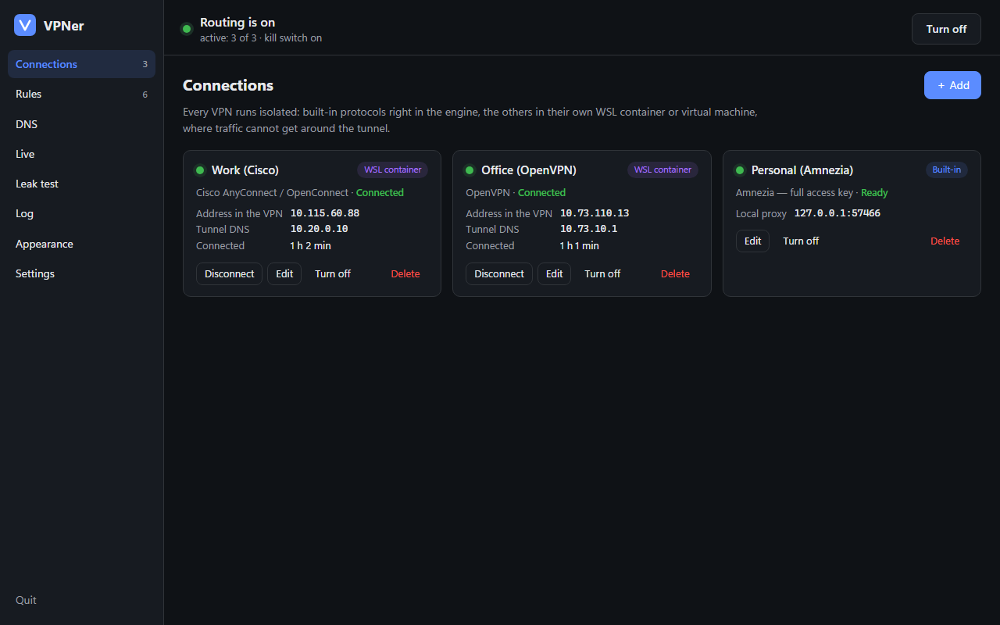
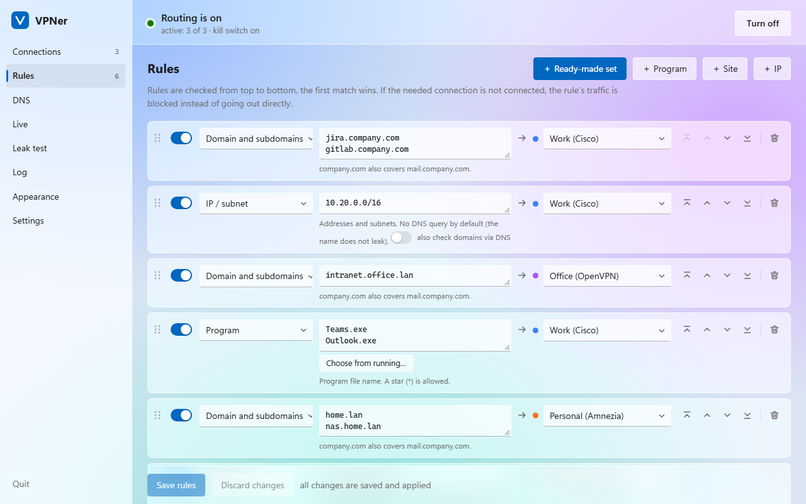
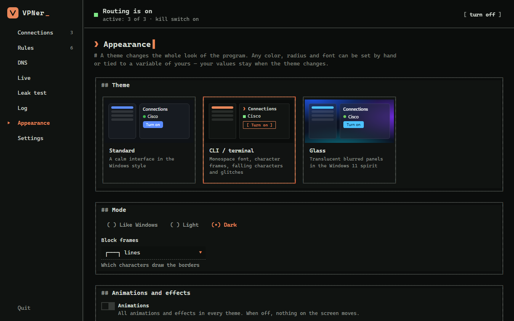

<div align="center">

# VPNer

**Several VPNs at once on Windows — without conflicts and without leaks.**
Every program, site and IP goes through the connection you choose.

[](#requirements)
[](#project-status)
[](#project-status)

**English** · [Русский](README.ru.md)



</div>

## What it is

A corporate Cisco for your job, OpenVPN into a client's network, your own WireGuard or AmneziaWG to your home network or servers — normally these VPNs fight over routes, DNS and kill switches, and traffic of one leaks through another. VPNer runs them **side by side, each in isolation**, and sends traffic by your rules:

- `jira.company.com`, `10.20.0.0/16`, `Teams.exe` → the work Cisco;
- `intranet.office.lan` → the office OpenVPN;
- `nas.home.lan`, `192.168.50.0/24` → your personal VPN;
- everything else → directly.

If a VPN goes down, its rules **block** traffic instead of letting it out directly.

## Features

- **Many VPN types:**
  - **built in:** WireGuard, AmneziaWG (including 2.0 and the full access key of your own Amnezia server), VLESS/Reality, VMess, Trojan, Shadowsocks, Hysteria2, TUIC;
  - **in isolated WSL containers:** Cisco AnyConnect / Secure Client (OpenConnect), GlobalProtect, Fortinet, Pulse/Ivanti, F5, OpenVPN;
  - **in a Hyper-V virtual machine:** any original VPN app (AmneziaVPN, Cisco Secure Client, provider clients).
- **Rules:** by program, program path, domain, domain suffix, keyword, regex, IP/subnet, site category (geosite), IP country, port and protocol. Ready-made sets of popular services, drag & drop ordering, a "where will it go?" check.
- **DNS:** DoH, DoH3, DoT, DoQ, UDP/TCP and the system resolver; each server can go directly or **through any VPN**; per-domain DNS rules; FakeIP so that DNS never leaks.
- **Logins:** saved passwords (encrypted with DPAPI), MFA codes, push confirmations (Duo, Telegram bots…), SAML/SSO in the browser. Corporate VPNs log in one at a time, so their push requests do not collide; idle sessions are kept alive.
- **Import:** a `vpn://` key, `.conf`, `.ovpn`, share links, subscriptions (Happ, v2rayN, Hiddify, Clash), a whole Clash/mihomo config, or a VPNer profile.
- **Leak test:** the real exit IP, DNS and latency of every connection.
- **Self-healing:** stalled tunnels are rebuilt automatically, crashed parts restart.
- **Appearance:** themes that change the whole look — Standard, **CLI / terminal** (character frames, falling characters, glitches, a decrypting screen) and **Glass** (Windows 11) — in light and dark, your own colors, fonts, radii and variables.
- **Languages:** English and Russian; adding a language is adding one file.

| | |
|---|---|
|  |  |
| Rules, Glass theme | Appearance, CLI theme |

## Requirements

- Windows 10 or 11, 64-bit, administrator rights (to capture traffic and run the kill switch).
- Microsoft Edge (it comes with Windows) — the window of the program is an Edge app window.
- For Cisco/OpenVPN: WSL 2 (VPNer installs it with one click if needed).
- For virtual machines: Windows Pro/Enterprise with Hyper-V.

Everything else (the mihomo engine, the WSL container, VM images) is downloaded on first use, pinned by version and checked by SHA-256/512.

## Install

Download from [Releases](../../releases/latest):

| File | What it is |
|---|---|
| `vpner-setup.exe` | Installer: choose a language and a theme, shortcuts, an entry in "Installed apps" |
| `VPNer-portable.zip` | Portable: unpack anywhere and run `vpner.exe`; everything stays in the `data` folder next to it |
| `SHA256SUMS.txt` | Checksums of the files |

The files are not signed yet, so Windows SmartScreen may say "Windows protected your PC": click **More info → Run anyway**.

Uninstall from Windows **Settings → Apps** or with `vpner.exe uninstall`; it asks whether to keep your settings.

## Quick start

1. Start VPNer and allow administrator rights.
2. **Connections → Add.** Paste a key or a config — the type is detected automatically.
3. **Rules.** Add programs, sites or subnets and choose a connection for each.
4. Click **Turn on**.

Do not run other VPN apps in Windows at the same time — they take over the routes again. Move them into VPNer (a key or a config) or into a VPNer virtual machine.

## How it works

```
 Windows programs ──► VPNer adapter (TUN) ──► rule engine (mihomo)
                                                  │
        ┌─────────────────────────────┬───────────┴───────────────┬──────────────────────┐
        ▼                             ▼                           ▼                      ▼
  Built-in protocols         WSL container (netns)        Hyper-V virtual machine   Direct / block
  WireGuard, AmneziaWG,      Cisco/OpenConnect,           original apps:
  VLESS/Reality, VMess,      GlobalProtect, Fortinet,     AmneziaVPN, Cisco Secure
  Trojan, SS, Hysteria2      Pulse, F5, OpenVPN           Client, provider clients
```

- **Built-in** tunnels run in a separate engine process that never reloads when rules change.
- **WSL containers:** every VPN gets its own network namespace whose only way out is its own tunnel. The daemons reach their servers through the VPNer agent over the stdio of `wsl.exe`, so WSL networking modes, firewalls and other kill switches do not matter.
- **Virtual machines** (Debian 13 with a desktop) are created automatically; the gateway inside can send traffic only through the VPN app's tunnel (nftables).

### Leak protection

| Risk | What VPNer does |
|---|---|
| One VPN's traffic goes through another | VPNs are isolated in namespaces or VMs |
| A VPN dropped and traffic went out directly | Rules leading to a VPN that is down **block** traffic |
| DNS leaks | DNS is captured, FakeIP; names for a VPN are resolved inside its tunnel |
| A program ignores proxies | TUN captures all IP traffic of the computer |
| IPv6 around the tunnel | IPv6 follows the same rules; it is off inside containers |
| VPNer itself crashes | The system kill switch (Windows Firewall) blocks the internet |
| Not sure | The **Leak test** tab shows the real exit IP of every connection |

## If the internet is gone

With the kill switch on, the internet stays closed while VPNer is not running. To lift it: tray icon → **Restore the network**, **Settings → Maintenance**, or:

```bash
vpner.exe restore
```

## Build from source

```bash
powershell -ExecutionPolicy Bypass -File build.ps1
```

The script downloads a pinned Go toolchain into `.tools`, builds the Linux agent (amd64 and arm64), embeds it into `vpner.exe` and puts `vpner.exe`, `vpner-setup.exe` and `VPNer-portable.zip` into `dist\`. Use `-Arch arm64` or `-Arch all` for ARM Windows. See [CONTRIBUTING.md](CONTRIBUTING.md) for tests, the project layout and translations.

## Limitations

- OpenConnect runs over TLS without DTLS (UDP does not go through the uplink); for corporate access this is usually enough.
- Cisco servers that require HostScan/posture checks need the original client in a virtual machine.
- Virtual machines need Windows Pro/Enterprise with Hyper-V; their first setup takes 10–15 minutes.

## Author

**programmer2005** — just a student who needed several VPNs at once for work: a few corporate ones plus a personal one. They kept conflicting with each other, and that is how VPNer appeared.

- Telegram: [@programmer2005](https://t.me/programmer2005)
- GitHub: [progr4mmer2005](https://github.com/progr4mmer2005)

## Support the project

If VPNer saves you time, you can support its development on **[Boosty](https://boosty.to/programmer2005/donate)** — any amount helps.

## Project status

> [!IMPORTANT]
> **This project is entirely vibe-coded.** Every line of it was written by **Claude Opus 5.5** (Anthropic) in Claude Code, directed by the author. It works on the author's machine every day, but it is an early beta that has not been audited. Test it before you rely on it, especially the leak protection.

Found a bug or have an idea? Open an [issue](../../issues/new/choose) or write to **jackjackjackjack024@gmail.com**. Security problems: see [SECURITY.md](SECURITY.md).

There is no license yet: the code is published for review and testing. Ask the author before reusing it.
