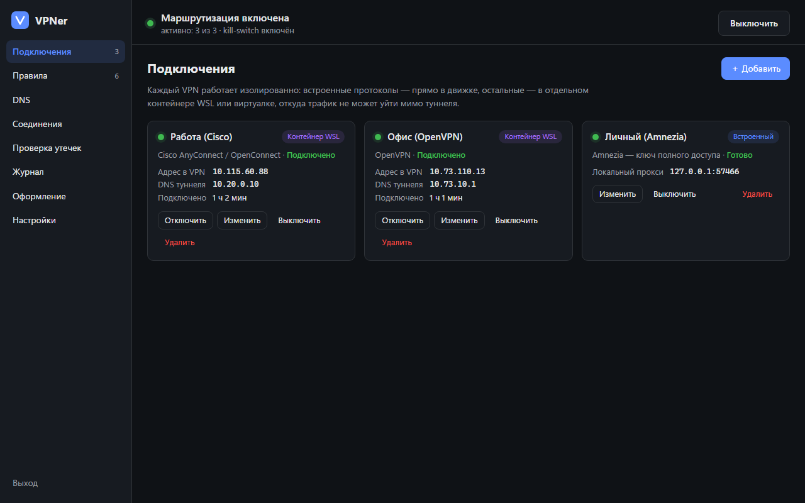
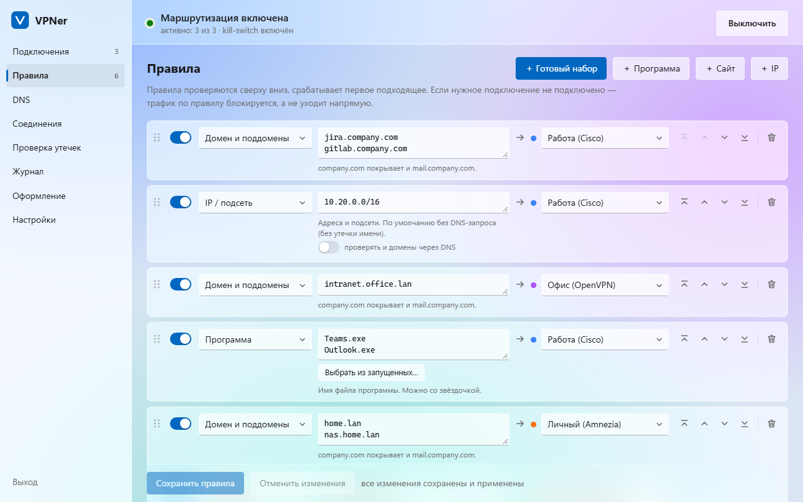
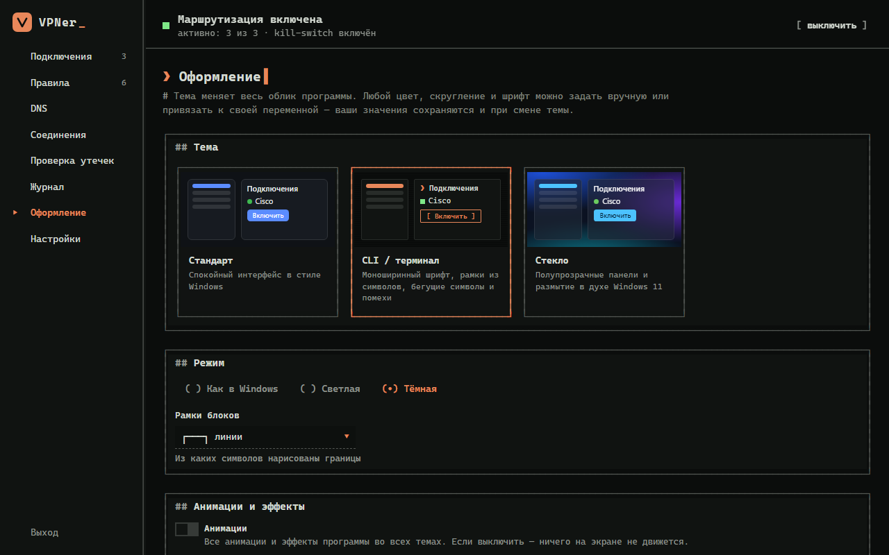

<div align="center">

# VPNer

**Несколько VPN одновременно в Windows — без конфликтов и утечек.**
Каждая программа, сайт и IP идут через то подключение, которое вы выбрали.

[](#требования)
[](#статус-проекта)
[](#статус-проекта)

[English](README.md) · **Русский**



</div>

## Что это

Корпоративный Cisco для работы, OpenVPN в сеть заказчика, свой WireGuard или AmneziaWG до домашней сети или серверов — обычно такие VPN дерутся за маршруты, DNS и kill-switch, а трафик одного утекает через другой. VPNer держит их **рядом и изолированно** и направляет трафик по вашим правилам:

- `jira.company.com`, `10.20.0.0/16`, `Teams.exe` → рабочий Cisco;
- `intranet.office.lan` → офисный OpenVPN;
- `nas.home.lan`, `192.168.50.0/24` → ваш личный VPN;
- всё остальное → напрямую.

Если VPN отвалился, его правила **блокируют** трафик, а не выпускают его напрямую.

## Возможности

- **Много видов VPN:**
  - **встроенные:** WireGuard, AmneziaWG (включая 2.0 и ключ полного доступа к своему серверу Amnezia), VLESS/Reality, VMess, Trojan, Shadowsocks, Hysteria2, TUIC;
  - **в изолированных контейнерах WSL:** Cisco AnyConnect / Secure Client (OpenConnect), GlobalProtect, Fortinet, Pulse/Ivanti, F5, OpenVPN;
  - **в виртуалке Hyper-V:** любая оригинальная VPN-программа (AmneziaVPN, Cisco Secure Client, клиенты провайдеров).
- **Правила:** по программе, пути к программе, домену, домену с поддоменами, слову, регулярному выражению, IP/подсети, категории сайтов (geosite), стране IP, порту и протоколу. Готовые наборы популярных сервисов, перетаскивание, проверка «куда пойдёт?».
- **DNS:** DoH, DoH3, DoT, DoQ, UDP/TCP и системный; каждый сервер можно пустить напрямую или **через любой VPN**; правила DNS для доменов; FakeIP, чтобы DNS не утекал.
- **Вход:** сохранённые пароли (шифруются DPAPI), коды MFA, push-подтверждения (Duo, Telegram-боты…), SAML/SSO в браузере. Корпоративные VPN входят по очереди, чтобы их push-запросы не мешали друг другу; простаивающие сессии поддерживаются.
- **Импорт:** ключ `vpn://`, `.conf`, `.ovpn`, ссылки, подписки (Happ, v2rayN, Hiddify, Clash), целый конфиг Clash/mihomo или профиль VPNer.
- **Проверка утечек:** реальный выходной IP, DNS и задержка каждого подключения.
- **Самовосстановление:** зависшие туннели пересоздаются сами, упавшие части перезапускаются.
- **Оформление:** темы, которые меняют весь облик — «Стандарт», **CLI / терминал** (рамки из символов, падающие символы, помехи, расшифровка экрана) и **Стекло** (Windows 11) — в светлом и тёмном варианте, свои цвета, шрифты, скругления и переменные.
- **Языки:** русский и английский; чтобы добавить язык, достаточно одного файла.

| | |
|---|---|
|  |  |
| Правила, тема «Стекло» | Оформление, тема CLI |

## Требования

- Windows 10 или 11, 64-бит, права администратора (для перехвата трафика и kill-switch).
- Microsoft Edge (он есть в Windows): окно программы — это окно-приложение Edge.
- Для Cisco/OpenVPN: WSL 2 (VPNer поставит его одной кнопкой, если нужно).
- Для виртуалок: Windows Pro/Enterprise с Hyper-V.

Всё остальное (движок mihomo, контейнер WSL, образы ВМ) скачивается при первой необходимости, закреплено по версии и проверяется по SHA-256/512.

## Установка

Скачайте из [Releases](../../releases/latest):

| Файл | Что это |
|---|---|
| `vpner-setup.exe` | Установщик: выбор языка и темы, ярлыки, пункт в «Приложениях» |
| `VPNer-portable.zip` | Portable: распакуйте куда угодно и запустите `vpner.exe`; всё хранится в папке `data` рядом |
| `SHA256SUMS.txt` | Контрольные суммы файлов |

Файлы пока не подписаны, поэтому Windows SmartScreen может показать «Система Windows защитила ваш компьютер»: нажмите **Подробнее → Выполнить в любом случае**.

Удаление — в **Параметры → Приложения** или командой `vpner.exe uninstall`; программа спросит, сохранить ли настройки.

## Быстрый старт

1. Запустите VPNer и разрешите права администратора.
2. **Подключения → Добавить.** Вставьте ключ или конфиг — тип определится сам.
3. **Правила.** Добавьте программы, сайты или подсети и выберите для каждого подключение.
4. Нажмите **Включить**.

Не запускайте одновременно другие VPN-программы в Windows: они снова начнут перехватывать маршруты. Перенесите их в VPNer (ключ или конфиг) или в виртуалку VPNer.

## Как это устроено

```
 Программы Windows ──► адаптер VPNer (TUN) ──► движок правил (mihomo)
                                                  │
        ┌─────────────────────────────┬───────────┴───────────────┬──────────────────────┐
        ▼                             ▼                           ▼                      ▼
  Встроенные протоколы       Контейнер WSL (netns)        Виртуалка Hyper-V        Напрямую / блок
  WireGuard, AmneziaWG,      Cisco/OpenConnect,           оригинальные программы:
  VLESS/Reality, VMess,      GlobalProtect, Fortinet,     AmneziaVPN, Cisco Secure
  Trojan, SS, Hysteria2      Pulse, F5, OpenVPN           Client, клиенты провайдеров
```

- **Встроенные** туннели работают в отдельном процессе движка, который не перезагружается при смене правил.
- **Контейнеры WSL:** у каждого VPN свой сетевой namespace, и единственный выход из него — свой туннель. До своих серверов демоны доходят через агент VPNer по stdio процесса `wsl.exe`, поэтому режим сети WSL, брандмауэры и чужие kill-switch не мешают.
- **Виртуалки** (Debian 13 с рабочим столом) создаются автоматически; шлюз внутри может отправлять трафик только через туннель VPN-программы (nftables).

### Защита от утечек

| Риск | Что делает VPNer |
|---|---|
| Трафик одного VPN уходит через другой | VPN изолированы в namespace или ВМ |
| VPN упал, и трафик пошёл напрямую | Правила, ведущие в неработающий VPN, **блокируют** трафик |
| DNS-утечка | DNS перехватывается, FakeIP; имена для VPN разрешаются внутри его туннеля |
| Программа игнорирует прокси | TUN перехватывает весь IP-трафик компьютера |
| IPv6 в обход | IPv6 идёт по тем же правилам; в контейнерах он выключен |
| Падение самой программы | Системный kill-switch (Брандмауэр Windows) блокирует интернет |
| Сомнения | Вкладка **«Проверка утечек»** показывает реальный выходной IP каждого подключения |

## Если пропал интернет

Включённый kill-switch держит интернет закрытым, пока VPNer не работает. Снять его: значок в трее → **«Аварийно восстановить сеть»**, **Настройки → Обслуживание** или командой:

```bash
vpner.exe restore
```

## Сборка из исходников

```bash
powershell -ExecutionPolicy Bypass -File build.ps1
```

Скрипт сам скачает закреплённую версию Go в `.tools`, соберёт Linux-агент (amd64 и arm64), встроит его в `vpner.exe` и положит `vpner.exe`, `vpner-setup.exe` и `VPNer-portable.zip` в `dist\`. Для ARM-Windows — `-Arch arm64` или `-Arch all`. Тесты, устройство проекта и переводы — в [CONTRIBUTING.md](CONTRIBUTING.md).

## Ограничения

- OpenConnect работает по TLS без DTLS (UDP не проходит через аплинк); для корпоративного доступа этого обычно хватает.
- Серверам Cisco с проверкой рабочего места (HostScan/posture) нужен оригинальный клиент в виртуалке.
- Виртуалкам нужна Windows Pro/Enterprise с Hyper-V; первая настройка ВМ занимает 10–15 минут.

## Об авторе

**programmer2005** — обычный студент. Для работы понадобилось держать несколько VPN сразу: пару корпоративных и свой личный. Они постоянно конфликтовали между собой — так и появился VPNer.

- Telegram: [@programmer2005](https://t.me/programmer2005)
- GitHub: [progr4mmer2005](https://github.com/progr4mmer2005)

## Поддержать проект

Если VPNer экономит вам время, поддержать разработку можно на **[Boosty](https://boosty.to/programmer2005/donate)** — любая сумма помогает.

## Статус проекта

> [!IMPORTANT]
> **Проект полностью навайбкожен.** Каждую строку кода написал **Claude Opus 5.5** (Anthropic) в Claude Code под руководством автора. У автора программа работает каждый день, но это ранняя бета без аудита. Проверьте её, прежде чем на неё полагаться, особенно защиту от утечек.

Нашли ошибку или есть идея? Создайте [issue](../../issues/new/choose) или напишите на **jackjackjackjack024@gmail.com**. Проблемы безопасности — см. [SECURITY.md](SECURITY.md).

Лицензии пока нет: код опубликован для просмотра и тестирования. Чтобы использовать его в своих проектах, спросите автора.
